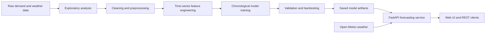

# Energy Consumption Forecasting for Dhaka City

An end-to-end machine learning project for forecasting daily electricity demand in Dhaka City. It combines historical demand, temperature, calendar effects, holidays, lag features, and rolling statistics to support short-term energy planning and peak-demand management.

The repository covers the full forecasting workflow: exploratory analysis, preprocessing, feature engineering, model development, leakage-safe ensemble evaluation, and deployment through a FastAPI service with a browser-based interface.

## Highlights

- Daily electricity-demand forecasting in megawatts (MW)
- Time-aware train, validation, and test splits
- Weather, calendar, seasonal, holiday, lag, and rolling-demand features
- Comparison of 11 regression models, including linear, tree-based, kernel, neural-network, boosting, and voting approaches
- Leakage-safe hybrid ensemble using Ridge, XGBoost, CatBoost, and SARIMAX
- One-day and recursive seven-day forecasts through a validated REST API
- Automatic Dhaka temperature collection from Open-Meteo or manual temperature input
- Interactive web interface plus Swagger and ReDoc documentation
- Reproducible notebooks, saved artifacts, evaluation reports, and automated tests

## Model performance

The advanced dynamic ensemble was evaluated with a causal rolling one-day-ahead backtest on 298 daily observations from January 1 to October 25, 2025.

| Metric | Dynamic ensemble | Previous project best | Improvement |
|---|---:|---:|---:|
| MAE | **228.29 MW** | 248.08 MW | **7.98%** |
| RMSE | **311.96 MW** | 336.54 MW | **7.30%** |
| R² | **0.794** | 0.761 | Higher is better |
| MAPE | **4.93%** | 5.32% | Lower is better |

These results use this project's processed dataset and explicit causal evaluation protocol. Scores reported by other studies may not be directly comparable when their data, code, or lag-update rules are unavailable.

## System workflow



## Data and features

The dataset contains daily observations beginning in 2021, with the following chronological split boundaries:

| Split | Period |
|---|---|
| Training | Through December 31, 2023 |
| Validation | January 1–December 31, 2024 |
| Test | January 1–October 25, 2025 |
| Future horizon | From October 26, 2025 |

Feature engineering includes:

- Calendar and cyclical signals such as weekday, month, quarter, day of year, and sine/cosine encodings
- Temperature transformations, cooling-degree effects, interactions, changes, and rolling statistics
- Dhaka-specific weekend and public-holiday indicators
- Demand lags at 1, 2, 7, 14, 28, 364, 365, and 371 days
- Rolling means, standard deviations, extrema, exponentially weighted means, and demand trends

All target-derived rolling features begin with a one-day shift to prevent the current target from leaking into its prediction.

## Models

The API exposes the following stable model choices:

1. Linear Regression
2. Ridge Regression
3. Lasso Regression
4. K-Nearest Neighbors
5. Random Forest
6. Extra Trees
7. CatBoost
8. Gradient Boosting
9. Support Vector Regression (RBF)
10. MLP Regressor
11. Voting Regressor

The research workflow also includes an advanced hybrid ensemble that combines:

- Trend-aware Ridge regression
- XGBoost trained on residual demand
- CatBoost trained on residual demand with Huber loss
- SARIMAX with weather and calendar regressors
- Expanding-window out-of-fold weights and adaptive recent-error weighting

The advanced hybrid ensemble is benchmarked separately and is intentionally not exposed by the current API.

## Project structure

```text
energy-consumption-forecasting-for_Dhaka_City/
├── data/
│   ├── raw/                 # Original source data
│   ├── processed/           # Cleaned EDA output
│   ├── preprocessed/        # Chronological model splits
│   └── features/            # Engineered forecasting features
├── notebooks/                   # EDA-to-model-development notebooks
├── src/
│   ├── advanced_hybrid_ensemble.py
│   └── api/                 # FastAPI backend and web interface
├── outputs/                     # Metrics, predictions, plots, and models
├── docs/                        # Technical and analysis documentation
├── tests/                       # API and ensemble tests
├── requirements-api.txt
└── requirements-advanced-ensemble.txt
```

## Quick start

### 1. Clone the repository

```bash
git clone git@github.com:i-am-rov/energy-consumption-forecasting-for_Dhaka_City.git
cd energy-consumption-forecasting-for_Dhaka_City
```

### 2. Create a virtual environment

```bash
python -m venv .venv
```

Activate it on Windows PowerShell:

```powershell
.\.venv\Scripts\Activate.ps1
```

Activate it on macOS or Linux:

```bash
source .venv/bin/activate
```

### 3. Install the API dependencies

```bash
python -m pip install --upgrade pip
python -m pip install -r requirements-api.txt
```

### 4. Start the application

```bash
python -m uvicorn src.api.main:app --host 0.0.0.0 --port 8000
```

Open the following pages:

- Forecast interface: <http://127.0.0.1:8000/>
- Swagger UI: <http://127.0.0.1:8000/docs>
- ReDoc: <http://127.0.0.1:8000/redoc>
- Health check: <http://127.0.0.1:8000/health>

## API overview

| Method | Endpoint | Purpose |
|---|---|---|
| `GET` | `/api/v1/metadata` | Read valid dates, constraints, holidays, and models |
| `GET` | `/api/v1/models` | Read the stable model-number mapping |
| `GET` | `/api/v1/weather/7-day` | Fetch seven days of Dhaka temperatures |
| `POST` | `/api/v1/forecast` | Generate a next-day forecast |
| `POST` | `/api/v1/forecast/7-day` | Generate recursive seven-day forecasts |
| `GET` | `/health` | Check service configuration and model artifacts |

Forecast dates and temperature constraints are dynamic. Clients should call `/api/v1/metadata` before constructing a request instead of hard-coding them.

Example request using temperatures from Open-Meteo:

```json
{
  "days": [
    {"forecast_date": "YYYY-MM-DD", "is_holiday": false},
    {"forecast_date": "YYYY-MM-DD", "is_holiday": false},
    {"forecast_date": "YYYY-MM-DD", "is_holiday": false},
    {"forecast_date": "YYYY-MM-DD", "is_holiday": false},
    {"forecast_date": "YYYY-MM-DD", "is_holiday": false},
    {"forecast_date": "YYYY-MM-DD", "is_holiday": false},
    {"forecast_date": "YYYY-MM-DD", "is_holiday": false}
  ],
  "model": "all",
  "collect_temperature_from_api": true
}
```

Replace the placeholders with the seven consecutive dates returned by `/api/v1/metadata`.

## Reproduce the advanced ensemble

```bash
python -m pip install -r requirements-advanced-ensemble.txt
python -m src.advanced_hybrid_ensemble
```

Generated artifacts are written to `outputs/advanced_ensemble/`, including the benchmark summary, model comparison, predictions, feature importance, forecast plot, and serialized ensemble.

## Run the tests

```bash
python -m pytest -q
```

The test suite checks feature chronology, adaptive ensemble causality, model artifacts, API validation, recursive forecasts, weather integration, and error responses.

## Documentation

- [`docs/FASTAPI.md`](docs/FASTAPI.md) — API contract, model catalog, validation rules, and request examples
- [`docs/Advanced_Hybrid_Ensemble_Report.md`](docs/Advanced_Hybrid_Ensemble_Report.md) — architecture, evaluation protocol, and benchmark interpretation
- `notebooks/` — data preprocessing, EDA, feature engineering, model development, and ensemble experimentation

## Technology stack

Python, pandas, NumPy, scikit-learn, CatBoost, XGBoost, statsmodels, FastAPI, Uvicorn, Pydantic, Matplotlib, and Jupyter.

## Responsible use

This project is intended for research, planning, and decision support. Forecast accuracy can change under unusual weather, infrastructure changes, demand shocks, or data drift. Operational energy decisions should combine model output with current grid conditions and expert review.

## Author

Developed by [i-am-rov](https://github.com/i-am-rov).
